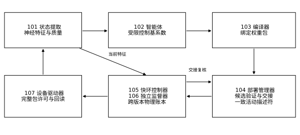
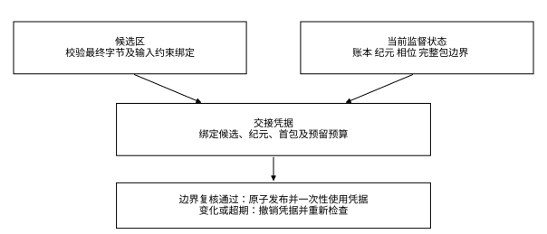

中国移动专利申请
技术交底书

## 一、发明名称

基于智能体权重编程的脑机闭环控制系统及方法。

## 二、技术领域

本申请涉及脑机接口和嵌入式控制，具体涉及智能体生成的控制器权重在脑机设备中的校验、在线部署和输出监督。通过将权重及配置绑定、交接时复核和跨版本输出记账结合，防止控制器更新时使用失效验证结果、混用配置或重置累计输出预算。

## 三、现有技术的技术方案

闭环脑机设备通常包括脑电或局部场电位采集、状态估计、控制器和驱动器。WO2026122695A1已公开大语言模型生成神经刺激编程建议；WO2020097618A1已公开神经网络识别生理状态，并通过固件更新接收网络权重。双时间尺度规划、网络权重更新及相位控制均不能单独作为本申请的新颖点。

与部署相关的WO2022245878A1已公开刺激参数认证、有效期及数字剂量计数；US8391972B2已公开独立安全控制；US20180365181A1公开安全双缓冲；US20230143265A1公开隔离测试与运行中替换程序。HyperNetworks、任务向量算术及低秩适配也已有公开。相关日期、出处和技术边界见配套检索报告。

## 四、现有技术的缺点及本申请要解决的技术问题

当上述技术用于持续工作的脑机控制器时，仍须处理三个相互关联的问题：（1）接收时验证通过的候选，在等待激活期间可能遇到约束调整、输入配置变化或输出预算消耗，原验证结果随之失效；（2）权重更新若同时重建监督状态，可能清除已发生的电荷、能量或占空比记录；（3）仅交换权重地址，可能在完整波形包尚未结束时切换，或使新权重与旧归一化、旧控制状态混用。

本申请解决的技术问题是：如何使慢速权重编程与本地连续控制并行，并使每次部署针对当前设备配置、当前输出历史和完整波形边界生效，而不是仅对接收时的静态参数负责。上述为所针对的故障条件，不认定所有现有设备均存在这些缺陷。

## 五、本申请的技术方案的详细阐述

（1）系统结构。图1中，状态提取模块101输出神经信号特征及质量标记；智能体102在慢环形成控制基系数；编译器103生成可加载权重包；本地部署管理器104管理活动区与候选区；快环控制器105产生候选驱动参数；独立监督器106保有输出账本并向驱动器107发放逐包许可。智能体不能写驱动寄存器、修改账本或放宽设备约束。

慢环可每2秒或在状态变化时执行；快环可按1 kHz本地时钟执行，均为实施配置而非实测时延。前者延迟或失联不阻塞后者。活动包失效、输入质量不合格或本地许可失败时，停止发出新波形包；已启动包由独立硬件路径按设备预定规则完成补偿或故障处置。

（2）输入与权重生成。一个可实施控制器采用16维输入、32维ReLU隐藏层和4维输出。输入为四通道各两个频带的归一化功率、相位正弦及余弦、四个通道质量值、距上一完整包的时间和剩余预算比例。输出为门控分值、幅值候选、相位偏移候选及包宽度候选，须再转换为设备坐标并经监督器检查。

基控制器可用信号回放和台架参考控制器的输入输出对，按采集会话划分训练与验证记录，通过均方误差训练；再对不同跟踪目标微调取得控制基。示例采用Adam、学习率0.001和最多50轮训练，并以独立回放筛除超出设备约束的控制基。上述数值只说明一条实施路径，不作为保护范围的必要限制。

智能体读取带时间戳的状态摘要、目标、当前包版本和受信控制基目录，按固定字段输出基编号、有限系数、适用输入域和申请有效期。编译器拒绝缺字段、非数、越权配置和越界系数，按式（1）合成权重；也可使用经相同部署校验的超网络生成参数。

状态摘要还可由固定参考动力学网络的低秩参数增量编码。采用同一参考、参数排列和归一化版本，以重构或预测误差训练编码器，再将增量投影到校准状态基；非正交基使用正则最小二乘。状态基与控制基分属不同网络，不能直接相加；其版本须纳入输入配置绑定。该增量是模型参数表示，不是真实脑突触权重。

$$W_{new}=Q\left(W_0+\sum_{i=1}^{m}\alpha_i\Delta W_i\right)$$

式中，W0为固定基权重，ΔWi为同一参数排列下的控制基，αi为智能体提交的系数，Q为指定量化过程。低秩实现先重构实际执行矩阵，或用与设备一致的因子执行路径验证。完整性摘要覆盖最终量化字节；验证量化前浮点模型不能替代验证实际部署对象。

（3）静态绑定。权重包记录部署序号、基模型与控制基版本、最终权重摘要、输入模态及归一化摘要、驱动版本、受信约束摘要、有效期和交接阈值。受信约束包括允许输入域、输出量程、完整包检查规则、累计窗口及故障处置引用。签名或消息认证码验证来源；普通散列只校验完整性。

设备在候选区验证包来源、字节摘要、本地配置匹配及实际执行表示，并用同一回放输入比较新旧控制器输出。有效候选进入待交接状态。接收线程不得写活动区；候选所引用约束必须来自本地受信配置，不能由智能体随包放宽。

（4）动态交接复核。静态验证通过不等于允许立即激活。监督器另维护本地状态纪元e；约束、输入配置或输出账本发生影响许可的变化时递增e。相位兼容性则针对当前采样点单独检查，不能用接收时的相位代替。

在完整波形包结束后的控制边界，部署管理器读取当前输入、相位状态及账本快照，计算新控制器的首包候选；检查新旧输出差、状态可迁移性、当前剩余预算和包有效性。监督器据此形成一次性交接凭据，绑定候选摘要、约束摘要、e、目标采样序号、首包摘要和预留预算。

部署管理器与监督器在同一有界临界段内复核纪元及边界条件，并发布一个不可分割的活动描述符，内容包括权重、输入归一化引用、控制状态和受信约束引用。可用单写者中断任务和原子指针发布实现；快环每周期只读取一次描述符。旧区须待读者退出后复用。

若凭据产生后状态纪元变化、超过目标控制周期或首包内容变化，则撤销凭据、释放尚未执行的预留并重新检查；不得沿用过期的通过标记。首包启动时再次核对凭据和活动版本，并一次性消费许可。后续各包仍按实时账本独立申请，不因交接通过而获得长期通行权。

（5）跨版本输出账本。账本按实际物理通道或共享负载组索引，由监督器独立保存，不属于可切换的神经网络状态。电刺激记录每相电荷、净电荷及窗口内绝对电荷；声、磁等设备使用其适用能量、温度或占空比预算。不同物理量分别检查，不能互相抵销。

$$H_k+R_k+b_k\le B_k$$

式（2）逐资源成立。Bk为窗口预算，Hk为按执行回读确认的已发生量，Rk为已获许可但尚未记为实际发生量的预留，bk为本次完整包的最坏预算。启动前预留完整包，执行中按回读将预留转入已发生量；两者不得重复记账。完成后仅退还确认未发生的余量。

权重切换和回滚均沿用同一账本，不能把Hk置零。回滚复用旧权重内容，但生成新的递增部署序号，重新验证并交接；不得重放旧许可或恢复旧预算快照。只有物理时间窗正常滑出或确认未执行预留被取消时才能释放预算。重启后从受保护记录恢复；无法确认历史时闭锁至保守窗口结束。

例如某归一化窗口预算为10，旧控制器已消耗8，新控制器首包最坏需求为3，则必须拒绝，即使新权重已通过全部静态校验。若允许首包需求为2，执行后余额为0；随后回滚到旧权重也不能再次获得该窗口预算。数值为软件算例，无人体剂量含义。

（6）连续执行与故障处理。相位估计采用因果滤波或状态空间振荡器，以硬件时间戳预测实际驱动时刻；离线双向滤波不能用于主张在线零延迟。新旧控制器的循环状态可保留、经验证映射或在静默窗口重建；无法交接则保留仍有效的旧包，否则受控停止。

监督器在完整包启动前检查候选幅值、相位许可、每相及净电荷、间隔、输入质量和累计预算。双相电脉冲的补偿路径须由预定固件或硬件完成，不能因撤销新包许可而截断已启动包。质量下降、超时或失联时不再启动新包，异常执行回读使监督器闭锁并记录故障。

一项软件实施可采用四通道合成或已存储EEG、上述小型网络、两个权重缓冲和独立账本，驱动端接数字波形仿真器。配套参考程序已运行15个确定性场景，按预期完成交接或拒绝异常，覆盖约束变化、等待时预算消耗、脉冲中途更新、回滚和重放等。该程序仅验证顺序状态机，未覆盖实际模型训练、并发调度、密码认证、掉电持久化或硬件时延，不代表临床效果。

有创LFP或ECoG接口可沿用相同部署协议，但须分别校准量程、伪迹处理、输入域和设备约束。EEG、LFP和ECoG不能仅凭固定维度接口视为等价；血流动力学等慢信号只进入慢环。首次落地可在外置边缘控制器和组织等效负载上完成，无须为验证部署机制新增植入芯片。

## 六、本申请的关键点和欲保护点

主要保护脑机设备的控制器部署系统：权重规划与编译模块产生绑定输入配置及受信设备约束的权重包；本地管理器在候选区验证实际部署表示；监督器保有独立于控制器版本的物理输出账本，并针对当前账本、约束及控制状态核发与候选绑定的一次性交接凭据；在完整波形边界复核凭据后发布一致的活动描述符；后续输出及回滚均继续使用同一账本。上述特征共同限制激活资格和实际输出。

从属保护依次限定：（1）凭据绑定状态纪元、目标采样序号和首包摘要，变化即失效；（2）完整包预留、执行回读结转及未执行余量释放；（3）回滚使用新部署序号且不恢复旧预算；（4）量化字节与输入、约束共同校验；（5）大语言模型输出受限基系数或超网络参数；（6）相位与循环状态的边界交接。主项不限定模型品牌、固定频率、具体秩或缓冲区物理数量。

另保护读取已存储神经信号中间特征及设备配置、生成并验证上述绑定权重包、输出至部署接口的计算机实现方法，以及实现该方法的电子设备和存储介质。该方法终止于参数对象输出，不包含对人体实施刺激或形成疾病诊断结论的步骤。设备侧交接方案同时以系统结构和运行关系充分记载。

## 七、与第三条中最接近的现有技术相比，本申请有何技术优点

相对于WO2020097618A1的远程权重更新，本申请使激活时的实际状态参与许可，接收后发生变化即可使既有凭据失效；相对于WO2022245878A1的参数认证、期限及剂量计数，本申请把最终控制器表示、首包交接与跨版本物理账本关联起来；一般双缓冲和隔离测试并不自动建立这些关系。

直接效果是防止已知配置失配候选被激活、避免切换打断完整包，并使更新及回滚不能补回已消耗预算。该效果由检查条件和账本不变量支撑；不据此宣称治疗效果或优于全部产品。工程价值在于边缘软件可先行部署，并形成可复用的设备更新接口；目前不填写未经测算的收益或市场规模。

## 八、其他有助于理解本申请的技术资料

图1为模块及权限关系，图2为部署交接流程。“权重”包括可加载的矩阵、低秩因子或适配器参数；纯文本建议及未固化为参数的激活引导不当然属于相同技术对象。参考程序及原始场景输出置于本专利文件夹的evidence目录，供复现实施关系。

本申请将可制造设备及参数编译处理作为保护对象。神经信号输入、模型输出和驱动约束之间的关系按第五条给出，不以“非治疗”的名称替代实质判断。实际人体使用中的剂量、伦理和临床评价不由本软件算例推断。

## 九、本申请的侵权证据可获得性

优先保留可由协议、SDK、部署回执和授权台架测试获取的证据：权重及约束摘要、活动版本、交接采样序号、纪元失配拒绝码、包完成回读和跨版本账本连续性。在授权测试中，于候选等待期间改变约束或消耗预算，观察其是否复核；再在同一窗口切换或回滚，核查预算是否保留。

可将接口记录与物理输出波形按统一时钟对应，逐项映射第六条保护组合。原子描述符、内存隔离及内部账本的直接证明可能仍需固件轨迹或源代码。只有低延迟表现或AI宣传不足以证明全部特征；协议名称和散列算法不同也不能代替技术特征比对。
